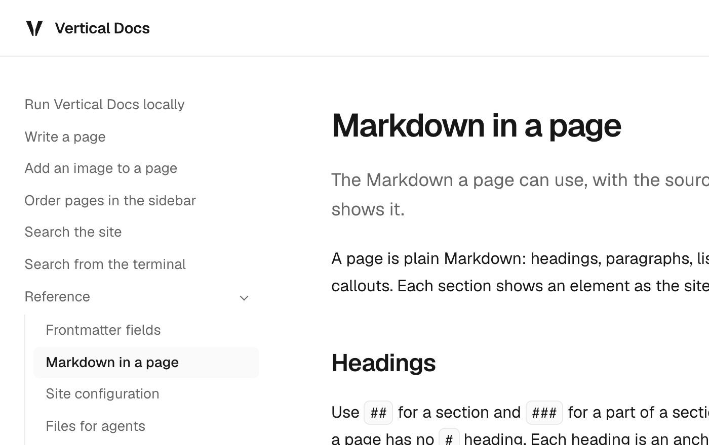
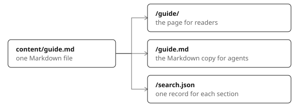

An image is a file in `content/`, beside the page that shows it. Write one Markdown line with the path of the file and a text that says what the image shows.

## Add the file and the line

Save the file beside the page, or in a folder beside the page. This site keeps its images in `content/images/`:

```text
content/
├── add-an-image.md
└── images/
    └── sidebar.png
```

In the page, write the alt text between the square brackets and the path from the page's file between the round brackets:

```md

```

The page shows the image at the width of the text column, and never larger than the file:


## What the build does with the file

The build writes the width and the height of the file into the page, so the text under the image does not move when the image arrives. The browser loads the image when the reader scrolls near it. A PNG or a JPEG file is served as WebP, and an SVG file is served as written.

The [Markdown copy of the page](/reference/agents/#markdown-copy-of-a-page) points at the same file as the page.

## Show a diagram in both themes

Draw the diagram once for each theme and end the two file names in `-light` and `-dark`. Write one line for each file, with the same alt text:

```md


```

The page shows the file for the theme in use, and changes the file when the reader switches the theme:


## Add a caption

There is no caption syntax. Write the caption as a line in italics under the image:

```md


*The group of the current page is open.*
```

## Follow the rules the build checks

The build stops when an image breaks one of these rules:

- An image has alt text. The alt text is what a screen reader, the search and an agent read in place of the image.
- An image is a file in `content/`. A web address or a path that starts with `/` is not allowed.
- The file name ends in `.png`, `.jpg`, `.jpeg`, `.webp`, `.avif`, `.gif`, `.svg` or `.tiff`, in lower case.
- The path is written in the image itself. An image that names a reference, such as `![The sidebar][sidebar]`, is not allowed.
- The alt text and the file name have no brackets, so that the Markdown copy of the page can point at the file.

The message names the page and the image:

```text
[ERROR] [glob-loader] Error rendering add-an-image.md: The image images/sidebar.png has no alt text. Write what it shows between the square brackets.
```
