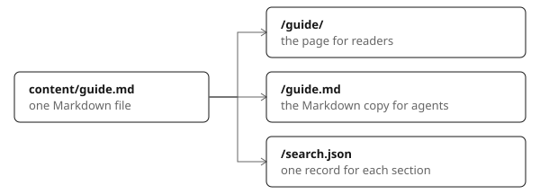

```sh
npx vertical-docs init
```

[Read the tutorial](/add-docs-to-your-repository/) · [All six commands](/reference/commands/) · [GitHub](https://github.com/VerticalStudio-ai/vertical-docs)\
Used by vAPI Network: [docs.vapinetwork.ai](https://docs.vapinetwork.ai)

## One Markdown file, three outputs

You write a page once. The build makes the page for readers, a Markdown copy for agents and the search records for both.




## What you get

- **Made for agents.** Every page has a Markdown copy at `.md`, the site has an `llms.txt`, and an MCP server answers at `/mcp`.
- **Kept current by agents.** `init` adds a few lines to `AGENTS.md` that tell your coding agent to change the page with the code.
- **Lives in your repository.** Plain Markdown in `docs/content/`. One file is one page, and a change to the docs is a pull request like any other.
- **Hosted by you.** Your own CI builds the site and deploys one Cloudflare Worker to your own account. Nobody edits online.
- **Fast and lightweight.** This site scores 100 in all four Lighthouse categories. A page loads 2.9 KB of CSS and 1.2 KB of JavaScript, gzipped.
- **Search that opens the right section.** Press `/` or ⌘K and type a word. A result opens the page at the heading that matched.

## Start with three commands

```sh
npx vertical-docs init     # writes docs/ with a first page and two workflows
npx vertical-docs dev      # live preview while you write
npx vertical-docs check    # the check CI runs
```

You need Node 22.23.4 or later. [Add docs to your repository](/add-docs-to-your-repository/) walks through each step.

## This site is the demo

This site is a folder of Markdown built with Vertical Docs. Press `/` to search it, add `.md` to the address of a page to read its Markdown copy, or start with [Run your docs locally](/run-your-docs-locally/).

## Open source

Vertical Docs is open source under the MIT licence. The code is on [GitHub](https://github.com/VerticalStudio-ai/vertical-docs) and the package is on [npm](https://www.npmjs.com/package/vertical-docs). Issues and pull requests are welcome: [CONTRIBUTING.md](https://github.com/VerticalStudio-ai/vertical-docs/blob/main/CONTRIBUTING.md) says how to run the project and what a change needs.
