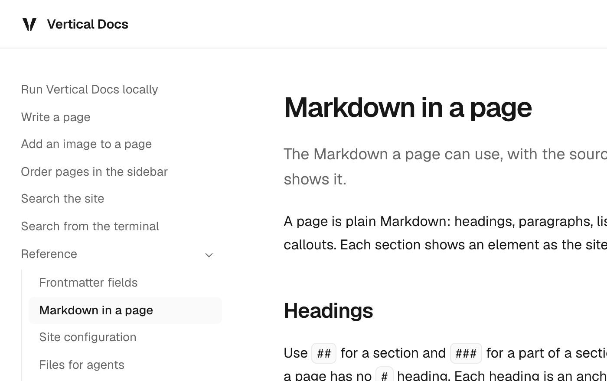

A page is plain Markdown: headings, paragraphs, lists, links, code, tables, images, quotes and callouts. Each section shows an element as the site renders it.

## Headings

Use `##` for a section and `###` for a part of a section. The page title comes from frontmatter, so a page has no `#` heading. Each heading is an anchor: the table of contents and other pages link to it.

### A part of a section

A `###` heading appears indented in the table of contents.

## Text and links

Write **bold** with two asterisks and *emphasis* with one. Link to another page by its path, [like this link to the first page](/), and to a section by adding the heading's anchor, [like this link to the callouts](#callouts). The build fails when a link or an anchor points nowhere.

## Lists

A list of items:

- One Markdown file is one page.
- One folder is one group in the sidebar.
- One configuration file sets the name and the accent colour.

A list of steps:

1. Run `pnpm install`.
2. Run `pnpm dev`.
3. Open `http://localhost:4321/`.

## Code

Write `inline code` between backticks. A code block starts with three backticks and the language:

```ts
type Page = { title: string; description: string; order?: number };

// Sorts pages by order, then by title.
export const sorted = (pages: Page[]) =>
	pages.toSorted((a, b) => rank(a) - rank(b) || a.title.localeCompare(b.title));

const rank = (page: Page) => page.order ?? Number.MAX_VALUE;
```

Use `sh` for commands and `text` for output:

```sh
pnpm check
```

Each code block has a Copy button in its top right corner.

## Tables

| Command | Does |
|---|---|
| `pnpm dev` | Starts the local site. |
| `pnpm check` | Checks the code, builds the site and checks the build. |
| `pnpm fix` | Formats the code and applies safe lint fixes. |

A table that is wider than the text scrolls sideways inside itself, on every screen size. The page stays as wide as the window.

## Images

Write the alt text between the square brackets and the path from the page's file between the round brackets:

```md

```


[Add an image to a page](/add-an-image/) shows where the file goes and how a diagram follows the theme.

## Quotes

A line that starts with `>` is a quote:

> Readers arrive from search, and agents fetch one section at a time.

## Callouts

A quote whose first line is one of four markers becomes a callout. Use a callout only for something the reader would otherwise get wrong.

```md
> [!NOTE]
> The local site reloads when you save a file.
```

> [!NOTE]
> The local site reloads when you save a file.

> [!TIP]
> Run `pnpm fix` before `pnpm check` to apply the formatting for you.

> [!WARNING]
> A renamed heading breaks every link to its anchor. `pnpm check` lists the broken links.

> [!CAUTION]
> Deleting a page removes its URL. Other sites that link to the URL get an error page.
